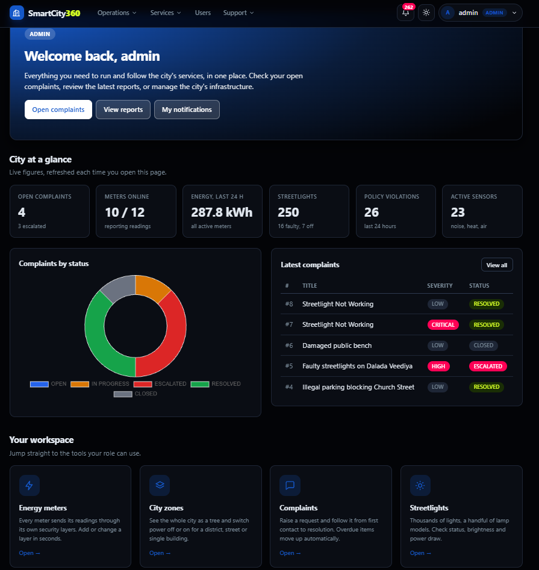
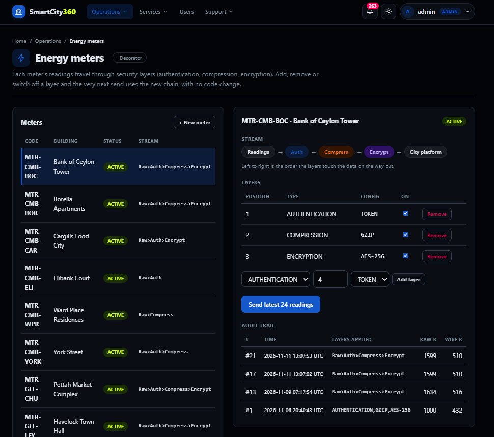
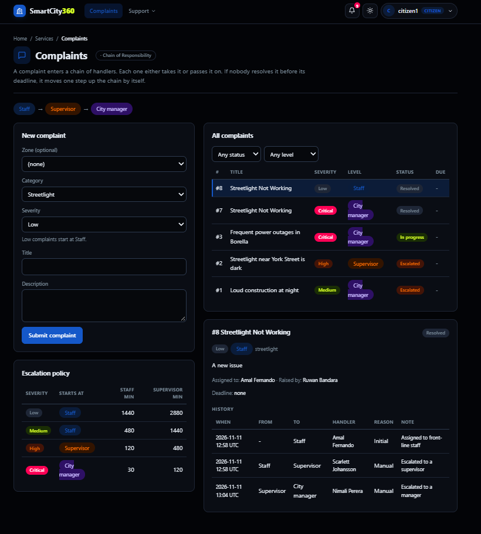
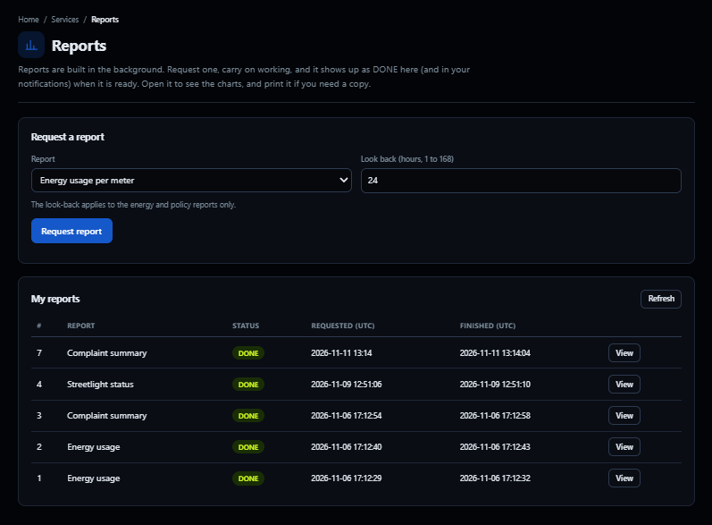
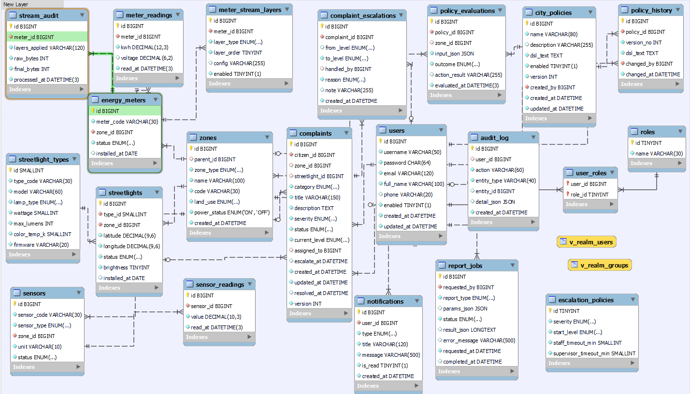

<h1 align="center">🏙️ SmartCity360</h1>

  
  
  
  
  
  

  <strong>SmartCity360</strong> is an enterprise-grade Jakarta EE smart-city operations platform for managing complaints, zones, streetlights, energy meters, and city policies. It features strict JWT security, JMS asynchronous messaging, and robust design patterns.

---

## 📖 Overview

**SmartCity360** is a modular, full-stack smart-city management system designed to streamline municipal operations. It provides distinct, role-based dashboards and administrative workflows for Citizens, Staff, Supervisors, City Managers, and Admins.

The backend uses a modular EAR architecture with Enterprise JavaBeans (EJB) for business logic, JMS for asynchronous processing, and JPA/Hibernate for data persistence. The frontend uses JSP for server-side rendering alongside REST APIs consumed via Vanilla JavaScript.

## ✨ Key Features

- **🔐 Advanced Security:** JWT authentication (HTTP-only cookies & Bearer tokens), SHA-256 hashing, role-access annotations, and login throttling.
- **🏙️ City Operations:** Hierarchical zone management, power shutdown workflows, and streetlight mapping.
- **📊 Energy & Sensors:** Energy meter processing, stream-layer audits, and automated sensor polling.
- **📝 Complaint Management:** Full lifecycle submission, assignment, escalation (Chain of Responsibility), and timeout processing.
- **📜 Policy Engine:** Policy creation, validation, version history, rollback, and scheduled evaluations.
- **⚙️ System Architecture:** Asynchronous report generation, JMS message-driven beans, and automated EJB scheduled jobs.
- **🧠 Design Patterns:** Implements Composite, Flyweight, Chain of Responsibility, Decorator, Interpreter, and Memento.

## 🛠️ Technology Stack

| Category | Technologies |
| :--- | :--- |
| **Backend** | Java 17, Jakarta EE 10, EJB 3.2, JAX-RS, JMS, Hibernate 6.5, JPA |
| **Frontend** | JSP, HTML5, CSS3, Vanilla JS, Chart.js, JSTL 3.0 |
| **Security** | JWT, HTTP-only Cookies, SHA-256, Servlet Filters |
| **Testing** | JUnit 5.11, Mockito 5.14, Arquillian 1.9, ShrinkWrap |
| **Build/Server**| Maven, GlassFish, MySQL 9.3 |

## 📸 System Showcase

| Admin Dashboard |                     Energy Meter Management                      |
| :---: |:----------------------------------------------------------------:|
|  |  |

| Citizen Complaint Portal | Administrative Reports |
| :---: | :---: |
|  |  |

## 🗄️ Database Schema

The application utilizes a highly relational MySQL schema managed via JPA/Hibernate. Key entity relationships include:

- **Users & Auth:** `User` (many-to-many with `Role`), `AuditLog`
- **City Infrastructure:** `Zone` (self-referencing hierarchy), `Sensor`, `Streetlight`
- **Energy Grid:** `EnergyMeter`, `MeterReading`, `MeterStreamLayer`
- **Operations:** `Complaint`, `ComplaintEscalation`, `EscalationPolicy`
- **Governance:** `CityPolicy`, `PolicyHistory`, `PolicyEvaluation`
- **System:** `Notification`, `ReportJob`

**Entity-Relationship Diagram:**

  

## 🏗️ System Architecture

1. **Deployment:** Modular EAR application comprising an EJB module, a WAR module, and an EAR assembly module.
2. **Client Layer:** JSP pages (server-side rendered) and Vanilla JS making `fetch()` requests to REST APIs.
3. **API Layer (JAX-RS):** Endpoints exposed under `/api`, protected by JWT filters.
4. **Business Layer (EJB):** Stateless session beans handle logic, scheduled jobs, and JMS messaging.
5. **Data Layer (JPA/Hibernate):** Object-relational mapping to a MySQL database.

## 🚀 Future Enhancements

- [ ] Migrate the frontend from JSP to a modern framework like React or Angular.
- [ ] Implement WebSockets for live, server-pushed dashboard updates.
- [ ] Integrate a real-time GIS (Geographic Information System) map for zone visualization.
- [ ] Add an IoT gateway adapter to ingest real-time hardware sensor data.

## 👨‍💻 Author

**Himansu Nethsara Ranasinghe**
- 🎓 BSc (Hons) Software Engineering Undergraduate (JIAT / BCU)
- 🔗 [LinkedIn](https://www.linkedin.com/in/himansu-nethsara/)
- 🐙 [GitHub](https://github.com/HimansuNethsara)